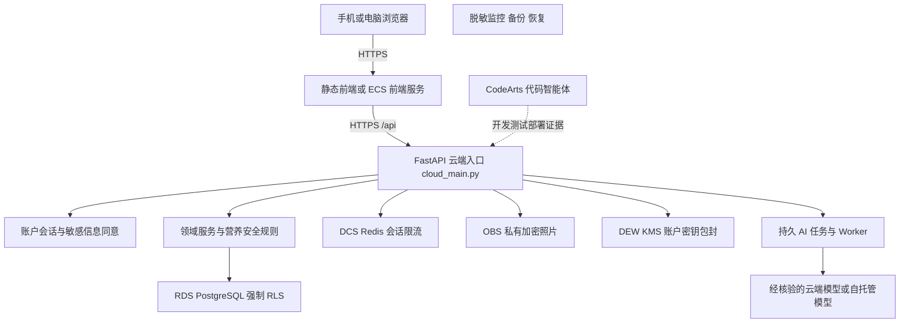

# 架构说明（当前实现与目标）

## 目标拓扑

## 当前已落地部分

| 组件 | 实现 | 文件 |
| --- | --- | --- |
| 云端入口 | FastAPI，关闭 docs/openapi，强 CORS 与精确 Origin 校验 | `app/backend/cloud_main.py` |
| 配置 | `DATABASE_URL` 必须 `postgresql+asyncpg`，OpenSSL 连接串支持 `sslmode` | `cloud/config.py` |
| 密钥包封 | `HuaweiKeyManager`（KMS），账户 UUID 放入明文做绑定 | `cloud/kms.py` |
| 数据加密 | 每账户 DEK + AES-256-GCM | `cloud/crypto.py` |
| 对象存储 | `HuaweiObjectStore`（OBS），私有 ACL + SSE，拒绝公开授权 | `cloud/object_store.py` |
| 会话/限流 | DCS Redis 共享，故障回退 PostgreSQL | `cloud/redis_store.py`、`cloud/auth.py` |
| 租户仓储 | RLS + 请求级租户上下文 | `cloud/repository.py` |
| 迁移 | 0001 表与 RLS、0002 认证支持、0003 账户密钥 | `cloud/migrations/versions/` |
| 健康检查 | `/health/live`、`/health/ready`（database/kms/object_store/cache） | `cloud_main.py` |

## 尚未落地

- 云端 AI 路由与 Worker：`cloud_main.py` 只挂载 6 个业务 router
- 照片识别：`cloud/photos.py` 只做加密存储
- 血压/静息心率字段
- 30 天报告窗口
- 真实华为云资源、域名、HTTPS、监控

## 部署形态

单容器，端口 8080，非 root（uid 10001），`deploy/cloud/Dockerfile`。构建、推送、ECS 启动脚本见 `deploy/huawei/`。

## 前端与 cookie

生产要求前端与 API 同主域不同子域，`FRONTEND_ORIGINS` 必须精确匹配；`VITE_API_BASE_URL` 只允许绝对 HTTPS origin，禁止携带凭据。若采用同站点反向代理 `/api`，需保证 Cookie `SameSite=Lax` 与 CSRF 头仍生效。