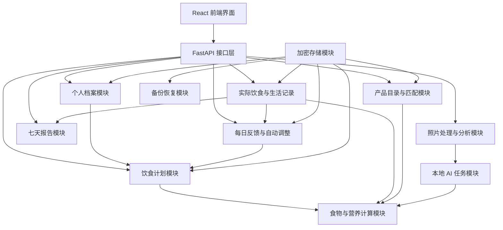
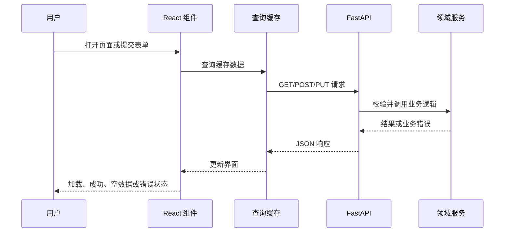
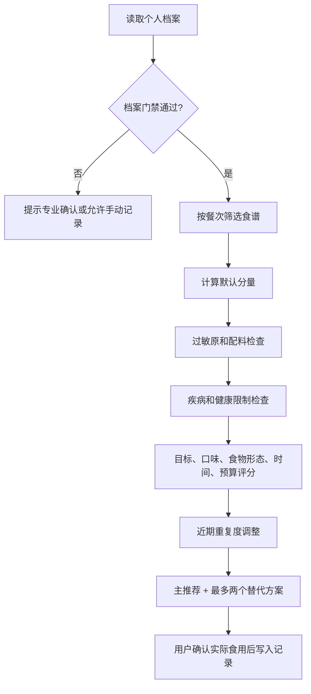
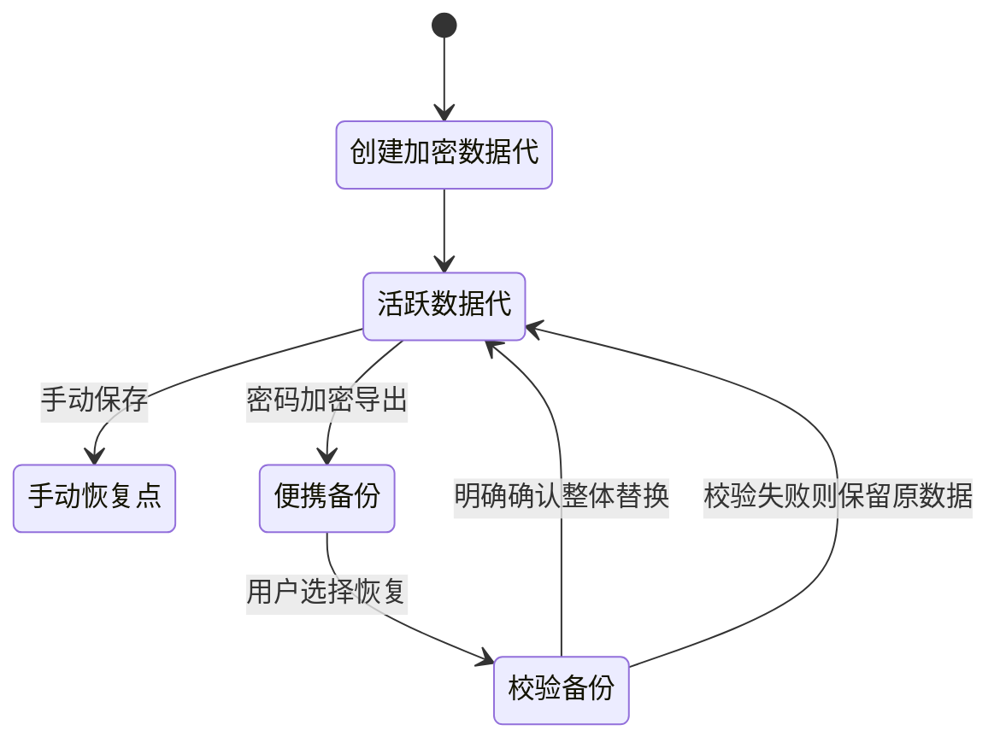
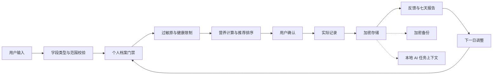

# 膳算关键技术模块介绍

## 1. 文档用途

本文用于说明“膳算”项目中具有代表性的技术模块、数据处理工具、关键算法和安全控制点，可作为软件著作权材料、项目答辩、技术交底和后续维护的辅助文档。

本文依据当前项目源码整理。当前主要运行形态为 Windows 本机版；安卓端是访问本机版的局域网伴侣端；云端多人版已有独立技术基础，但仍需完成真实云资源和生产验收。

## 2. 关键技术模块总览



系统将页面展示、接口路由、领域规则、营养计算和存储分层处理。前端负责输入和状态展示；FastAPI 负责会话、参数校验和接口编排；领域模块负责安全规则和营养业务；存储模块负责加密、版本、历史和恢复。

## 3. 前端交互与接口模块

### 3.1 使用的工具

- React 19：组织页面、表单、卡片、导航和状态界面。
- TypeScript：约束前端数据结构和接口调用参数。
- Vite：开发服务器和生产构建工具。
- React Router：管理首页、饮食计划、记录、报告、档案、产品等页面路由。
- TanStack Query：缓存查询结果、处理加载和错误状态，并在保存后刷新相关数据。
- Lucide 图标：提供统一的线性图标。

### 3.2 前端数据流



前端对“推荐”“计划”“实际记录”使用不同接口和状态字段，避免浏览推荐后自动产生摄入记录。写操作携带会话 Cookie 和 CSRF 标记，失败时保留用户输入，便于重试。

### 3.3 关键代码位置

```text
app/frontend/src/App.tsx              应用路由、云端/本机模式入口
app/frontend/src/api.ts               API 请求、会话和错误处理
app/frontend/src/Home.tsx             首页摘要和快捷入口
app/frontend/src/Meals.tsx            每日饮食计划
app/frontend/src/Records.tsx          饮食和生活记录
app/frontend/src/Profile.tsx          个人档案表单
app/frontend/src/Report.tsx           七天报告
app/frontend/src/Products.tsx         产品目录
app/frontend/src/style.css            主题、响应式和组件样式
```

## 4. 个人档案和安全前置判断模块

### 4.1 功能

个人档案模块保存用户的身体信息、生活状态、饮食目标、健康状况、疾病、过敏原、口味、饮食类型、烹饪方式和食物形态偏好。系统在自动生成计划前先执行档案门禁。

门禁会检查：

1. 是否已完成基本档案。
2. 是否明确确认过敏信息。
3. 是否明确确认健康状况。
4. 是否存在未覆盖的复杂疾病、孕期、未成年或术后等情况。
5. 过敏原是否存在可验证的匹配规则。
6. 食物库是否有足够的营养数据支持当前限制。

### 4.2 关键处理逻辑

源码位置：`app/backend/domain/plans.py` 中的 `profile_gate`。

```python
def profile_gate(profile):
    if not profile:
        return '请先完成个人档案'
    if profile['allergy_status'] == '未填写':
        return '请先确认过敏信息；未填写不能当作无过敏'
    if profile['health_status'] == '未填写':
        return '请先确认健康状况；未填写不能当作健康'

    complex_conditions = ['肾', '糖尿病', '高血糖', '术后', '肝脏', '心血管']
    if any(word in ' '.join(profile['conditions'])
           for word in complex_conditions):
        return '当前健康条件需要专业人员确认适用食物与分量'
    return None
```

该模块的设计重点是“未知不等于安全”。档案信息不足时，系统允许继续手动记录，但暂停自动定量推荐。

## 5. 食物资料和营养计算模块

### 5.1 数据来源和工具

- `app/resources/foods.json`：基础食物参考数据。
- `app/resources/recipes.json`：组合食谱和餐次信息。
- Python `json`：读取结构化食物和食谱资料。
- Python `math`：校验数值是否为有限数。
- FastAPI/Pydantic 路由校验：限制输入范围和字段类型。

每项食物的营养数据按照每 100g 保存。系统允许指标缺失，并使用 `None` 表示未知，不将未知营养素转换为 0。

### 5.2 分量换算

源码位置：`app/backend/domain/food.py` 中的 `Foods.calculate`。

```python
def calculate(self, items):
    result = []
    for item in items:
        grams = number(item.get('grams'), 0.1, 5000, '食物重量（g）')
        food = self.get(item.get('food_id'))
        nutrients = {
            key: None if food['nutrients'].get(key) is None else
            round(food['nutrients'][key] * grams / 100, 4)
            for key in NUTRIENTS
        }
        result.append({
            'food_id': food['id'],
            'name': food['name'],
            'grams': grams,
            'nutrients': nutrients,
            'allergens': food['allergens'],
            'source': food['source'],
            'state': food['state'],
        })
    return result
```

计算公式为：

```text
实际摄入值 = 每100g营养值 × 实际食用克数 ÷ 100
```

### 5.3 缺失数据聚合

源码位置：`app/backend/domain/food.py` 中的 `aggregate`。

聚合结果同时记录：

- 已知值 `known`。
- 未知项目数量 `unknown`。
- 是否完整 `complete`。
- 完整数据才提供 `total`。
- 营养素名称和单位。

因此页面可以准确显示“蛋白质 35g，仅已知部分”，而不是显示一个看似完整的结果。

## 6. 个性化饮食推荐模块

### 6.1 推荐流程



### 6.2 风险过滤

源码位置：`app/backend/domain/plans.py` 中的 `food_risks` 和 `allowed`。

```python
def food_risks(profile, items):
    reasons = []
    for item in items:
        if not item.get('ingredients_complete'):
            reasons.append(item['name'] + '：配料不完整，不能确认过敏风险')
        for allergen in profile['allergens']:
            tokens = ALLERGEN_ALIASES.get(allergen, {allergen})
            if set(item.get('allergens', [])) & tokens:
                reasons.append(item['name'] + '：可能涉及' + allergen)
    return list(dict.fromkeys(reasons))
```

推荐排序遵循安全优先原则。只要存在明确过敏冲突、关键配料不完整或疾病限制无法核对，该候选就不能进入推荐结果。评分只在安全检查通过后使用，用于处理目标、口味、预算、准备时间和近期重复。

### 6.3 计划和实际记录分离

推荐计划中的餐食带有 `pending` 状态。用户点击确认实际食用后，系统才调用记录服务生成实际记录，并将餐次状态改为 `recorded`。替换、跳过和调整分量只改变计划，不会自动增加当天摄入。

## 7. 饮食记录和幂等保存模块

### 7.1 数据版本

本机存储使用实体版本号和历史表：

- 新建实体从版本 1 开始。
- 修改前把旧版本写入 `history`。
- 更新时校验客户端提交的版本。
- 版本不一致时返回冲突，避免覆盖另一处新修改。

### 7.2 幂等请求

网络重试或用户重复点击保存时，系统使用请求标识避免重复写入：

```python
def mutate(self, key, payload, operation):
    digest = sha256(encode(payload).encode()).hexdigest()
    with self.atomic():
        old = self.conn.execute(
            'SELECT digest, result FROM requests WHERE key=?', (key,)
        ).fetchone()
        if old:
            if old['digest'] != digest:
                raise conflict('操作标识已被其他内容使用，请重新发起')
            return json.loads(old['result'])
        result = operation()
        self.conn.execute(
            'INSERT INTO requests VALUES (?,?,?)',
            (key, digest, encode(result))
        )
        return result
```

该机制用于饮水、记餐、反馈和其他可重试操作，保证重复请求不会产生重复记录。

## 8. 本机加密存储模块

### 8.1 数据处理工具

- SQLite：保存结构化实体、版本和关联关系。
- SQLCipher：对数据库文件进行透明加密。
- `cryptography`：提供 AES-GCM、Scrypt 和相关密码学实现。
- Windows DPAPI：将数据库生成的随机主密钥绑定到当前 Windows 用户。
- 原子文件替换：写入临时文件后通过替换操作提交，减少中途断电造成的半文件。

### 8.2 文件加密

源码位置：`app/backend/storage/crypto.py`。

```python
def encrypt(key: bytes, data: bytes, context=b'mna-file-v1') -> bytes:
    nonce = os.urandom(12)
    return MAGIC + nonce + AESGCM(key).encrypt(
        nonce, data, context
    )

def decrypt(key: bytes, data: bytes, context=b'mna-file-v1') -> bytes:
    if len(data) < 32 or data[:4] != MAGIC:
        raise CryptoError('文件格式无效')
    return AESGCM(key).decrypt(
        data[4:16], data[16:], context
    )
```

AES-GCM 同时提供机密性和完整性校验。照片、附件和便携备份都带有不同的用途上下文，避免一份密文被错误地当作另一类文件解密。

### 8.3 本机数据生命周期



系统不会因浏览器刷新、关闭窗口或清除站点数据而删除独立数据目录。整体恢复前会先检查格式、版本和完整性，恢复失败时保留原数据。

## 9. 照片处理和本地 AI 模块

### 9.1 图片预处理

源码位置：`app/backend/storage/photos.py`。

图片处理使用 Pillow 完成：

1. 限制最大文件大小为 12MB。
2. 只接受 JPG、PNG 和 WebP。
3. 校验像素数量，防止超大图像消耗过多内存。
4. 使用 EXIF 方向纠正。
5. 转换为 RGB 并缩放到最长边 1600 像素。
6. 统一编码为 JPEG 后再加密保存。

```python
with Image.open(io.BytesIO(data)) as image:
    image = ImageOps.exif_transpose(image).convert('RGB')
    image.thumbnail((1600, 1600))
    output = io.BytesIO()
    image.save(output, format='JPEG', quality=88)
    normalized = output.getvalue()
```

### 9.2 本地任务队列

照片分析和问答任务由本机任务模块排队处理。任务状态包括等待、运行、成功和失败；失败时保留真实错误状态，不伪造模型回答。任务结果写入应用的加密存储，并通过照片或问答接口返回给前端。

本地模型使用 Ollama 提供服务，模型准备完成后，照片和个人上下文不需要发送到第三方云端 AI 服务。

## 10. 产品目录与资料核实模块

产品模块用于保存自有产品和待核实产品资料。每项产品可以包含：品牌、名称、类别、图片、规格、配料、过敏原、营养标签、食用方法、保存方式、来源、核实人、核实日期和资料状态。

产品推荐使用以下技术门槛：

1. 先检查正式配料和过敏原。
2. 配料、过敏原或关键营养资料缺失时标记“资料待核实”。
3. 待核实产品不得进入营养统计。
4. 已核实产品也必须由用户主动加入计划。
5. 用户确认实际食用和分量后，才写入实际饮食记录。
6. 推荐理由引用产品资料和用户条件，并标记自有产品或推广内容。

这保证了产品浏览、产品推荐、计划餐食和实际摄入之间的数据边界。

## 11. 安卓局域网 HTTPS 网关

### 11.1 处理工具

- Java Android WebView：承载已有移动页面。
- Python Uvicorn：运行本机 HTTPS 网关。
- `httpx`：将允许的相对路径转发到本机 `127.0.0.1:18765`。
- `cryptography`：生成包含局域网 IP 的自签名证书。
- AndroidKeyStore：加密保存手机端的地址、凭据和证书指纹。

### 11.2 网关校验

源码位置：`app/backend/mobile.py`。

```python
if request.url.scheme != 'https':
    return failure('必须使用 HTTPS')
if request.headers.get('host') != authority:
    return failure('连接地址不匹配，请重新导入连接文件')
if not secrets.compare_digest(
        request.cookies.get('shansuan_mobile', ''), token):
    return failure('手机尚未配对或连接已失效', 'pairing')
if request.method not in ('GET', 'HEAD'):
    if not secrets.compare_digest(
            request.headers.get('x-csrf-token', ''), csrf):
        return failure('操作校验失败，请刷新页面后重试', 'csrf')
```

网关不接受客户端提供的任意上游地址，不转发浏览器 Cookie 和任意请求头，只转发固定本机接口。照片上传限制为 12MB，并限制并发请求数量。

## 12. 云端租户隔离和账户级加密模块

该模块用于后续云端多人版，不影响当前本机数据目录。

### 12.1 技术组件

- PostgreSQL：账号、会话、实体和历史数据。
- Alembic：数据库迁移。
- PostgreSQL RLS：强制限制账户只能访问自己的行。
- Argon2id：密码哈希。
- AES-256-GCM：业务实体密文。
- 阿里云 KMS：包封每个账户的数据密钥。
- `ContextVar`：保存当前请求经过认证的账户身份。

### 12.2 租户上下文

源码位置：`app/backend/cloud/context.py`。

```python
@contextmanager
def tenant_context(account_id: UUID):
    if not isinstance(account_id, UUID):
        raise TenantContextError('需要经过验证的账户标识')
    token = _TENANT_ID.set(account_id)
    try:
        yield
    finally:
        _TENANT_ID.reset(token)
```

云端业务仓储不接受客户端提交的 `account_id`，账户身份只能来自已验证会话。每个数据库事务执行 `SET LOCAL app.account_id`，再由 RLS 策略执行数据库级隔离。

### 12.3 账户数据加密

源码位置：`app/backend/cloud/crypto.py`。

```python
aad = b'shansuan-cloud-v1:' + account_id.bytes + b':' + associated_data
nonce = secrets.token_bytes(12)
ciphertext = AESGCM(account_key).encrypt(nonce, plaintext, aad)
return b'\x01' + nonce + ciphertext
```

账户 UUID 和实体类型进入附加认证数据，密文被复制到其他账户或被篡改时，解密校验失败。生产环境要求 KMS 配置和加解密探测成功，否则云端服务拒绝进入就绪状态。

## 13. 关键模块之间的安全数据流



图中每个箭头代表一次明确的数据边界。推荐结果不会自动变成摄入记录，产品资料不会绕过核实状态进入统计，未填写的营养指标不会被强制补零。

## 14. 异常、空数据和恢复处理

系统对异常状态进行显式处理：

- 档案未完成：提示继续完善或转为手动记录。
- 资料不足：显示“未记录”“待核实”或“仅为已记录部分”。
- 模型未准备：显示模型未就绪，不生成伪造回答。
- 保存冲突：提示刷新并保留原记录。
- 图片损坏或超大：拒绝保存并说明格式或大小要求。
- 数据库检查失败：拒绝创建空库替代，并提示使用有效备份恢复。
- 备份密码错误：拒绝恢复，不修改当前数据。
- 云端 KMS、数据库或对象存储不可用：健康检查返回未就绪，接口返回脱敏错误。

## 15. 典型测试模块

```text
app/tests/test_p0_crypto.py       本机加密和备份测试
app/tests/test_desktop.py         本机接口和数据读写测试
app/tests/test_mobile.py          安卓网关配对、CSRF、转发和上传测试
app/tests/cloud/                  云端认证、RLS、租户、隐私和产品测试
app/tests/*-browser.cjs          真实页面、移动布局和主题测试
```

测试使用独立临时目录和合成档案，不使用真实健康资料。重点验证以下结果：

1. 数据重启后仍可读取。
2. 错误密钥、篡改密文和错误账户不能解密。
3. 过敏冲突食物不会进入推荐。
4. 未核实产品不会进入摄入统计。
5. 重复请求不会创建重复饮食记录。
6. 手机未配对、来源错误或 CSRF 错误时被网关拒绝。
7. 移动端页面没有整体横向溢出，底部导航不会遮挡提交按钮。

## 16. 技术特点总结

- 使用本机加密文件保存个人数据，数据生命周期清晰。
- 使用规则优先的推荐方式，将安全限制放在目标和偏好之前。
- 通过版本号、历史记录和幂等键保证保存过程可追溯、可重试。
- 通过 Pillow 和 AES-GCM 处理照片的格式、大小、完整性和隐私。
- 通过局域网 HTTPS 网关让安卓端复用电脑能力，同时限制访问边界。
- 通过 PostgreSQL RLS、账户级 AES-GCM 和 KMS 为云端多人版建立租户隔离基础。
- 明确区分估算、待核实、已确认、计划和实际摄入，避免产生误导性营养结论。
