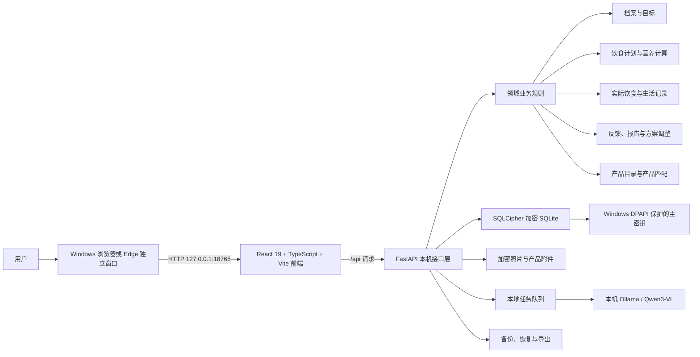
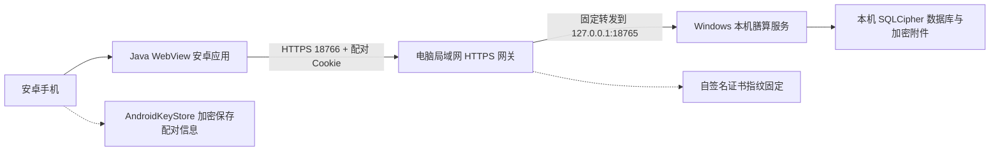
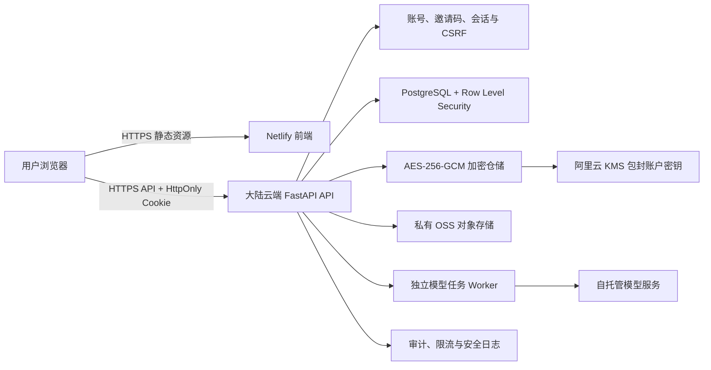
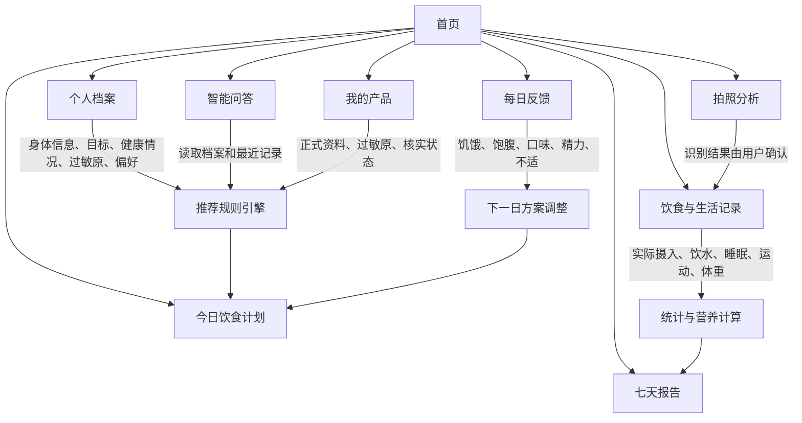
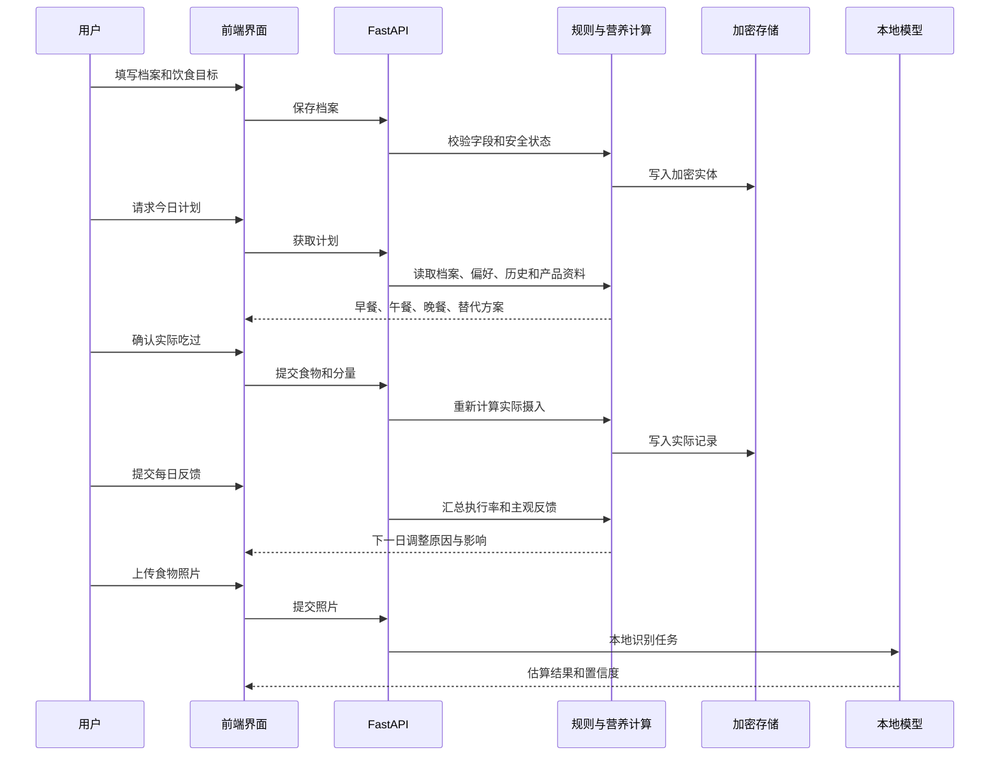

# 膳算整体技术方案介绍

## 1. 项目概述

**项目名称：** 膳算

**项目定位：** 膳算是一款面向个人营养与生活管理的应用，围绕“个人档案—饮食计划—实际记录—每日反馈—阶段报告—方案调整”建立持续记录和调整闭环。系统根据用户的身体信息、生活状态、饮食目标、健康情况、过敏原、口味偏好和食物形态偏好，提供日常饮食参考、记录和复盘功能。

系统的核心原则是：推荐与实际摄入分开、缺失数据不补零、估算值明确标注、过敏原和健康安全规则优先、个人资料默认私有。

当前项目包含三种运行形态：

1. **Windows 本机版：** 当前主要可用版本，数据保存在本机加密文件中。
2. **安卓局域网伴侣端：** 手机通过 HTTPS 局域网网关访问电脑上的本机版数据，电脑需要保持运行。
3. **云端多人版：** 已建立独立后端、数据库隔离和安全基础，仍处于开发与上线准备阶段，尚未作为公网生产服务交付。

## 2. 建设目标

- 帮助用户减少每天决定吃什么的负担。
- 将个人条件、饮食计划、实际饮食和主观反馈关联起来。
- 让用户能够查看已记录的能量、蛋白质、脂肪、碳水化合物、饮水和生活状态。
- 用七天报告帮助用户观察执行情况和变化趋势。
- 支持产品目录和自有产品推荐，同时保留资料核实、过敏原过滤和商业关系标识。
- 在本机版中保障健康档案、照片、饮食记录和备份文件的隐私。
- 为后续多人云端版本保留账号、租户隔离、云端加密和扩展能力。

## 3. 总体技术架构

### 3.1 当前本机版架构



本机版由 Python 启动器运行 FastAPI 服务。前端静态文件由同一服务提供，浏览器只访问回环地址，接口中间件校验本机 Host、Origin、会话 Cookie 和 CSRF 标记。后端通过领域服务处理档案、饮食、记录、反馈、报告和产品规则，存储层负责加密数据库、照片和备份。

### 3.2 安卓局域网伴侣端架构



安卓伴侣端不内置个人健康资料。电脑端生成带有局域网地址、随机访问凭据和证书 SHA-256 指纹的连接文件，用户私下导入手机。手机只接受该连接文件中的局域网 HTTPS 地址，并在 AndroidKeyStore 中加密保存配对信息。

手机端访问的数据仍然保存在电脑上，因此电脑必须开机、膳算服务和手机连接窗口必须运行，手机与电脑必须在同一局域网内。备份、恢复、整体删除和明文导出等管理操作保留在电脑端。

### 3.3 云端多人版目标架构



云端版本与本机版使用独立入口和独立数据边界。云端账户拥有独立租户空间，健康数据表使用 `account_id` 和 PostgreSQL 强制行级安全策略隔离；敏感个人信息写入依赖单独授权；账户数据使用 AES-256-GCM 加密，生产密钥由大陆地域的 KMS 管理。

当前云端版本已完成部分账号、隐私同意、租户仓储、产品模块和安全基础开发，但真实云资源、生产密钥、对象存储、持久模型任务、完整备份恢复和公网发布验收尚未完成。因此当前交付介绍以本机版为实际可运行基线。

## 4. 功能模块架构



### 4.1 个人档案

记录性别、年龄、身高、体重、腰围、体脂率、睡眠时长、运动次数、活动强度、生活状态、饮食目标、健康情况、疾病、过敏原、口味、饮食类型、烹饪方式和食物形态偏好。系统区分“未填写”和“明确无”，避免将未知健康信息误判为安全。

### 4.2 每日饮食计划

根据档案和当日状态生成早餐、午餐、晚餐及可选加餐，展示食物、分量、预计能量、蛋白质、脂肪、碳水化合物、膳食纤维及已有的钠、糖、嘌呤等指标。推荐同时展示理由、制作方式、准备时间、参考成本和至少两个替代方案。

推荐优先级为：过敏原安全 → 健康情况冲突检查 → 当前主要目标 → 口味和形态偏好 → 时间、预算与可执行性 → 饮食多样性。

### 4.3 拍照分析

本机模型对用户提供的照片给出食物名称、可能食材、估算分量、估算营养、可能过敏原和目标匹配提示。结果必须标记估算值与置信度，用户可以修改食物名称、配料和分量；只有用户确认实际食用后，才会写入实际记录。

### 4.4 饮食与生活记录

支持记录餐食、分量、进食时间、饱腹感、喜好程度、不适、推荐完成情况、饮水、睡眠、运动、体重和身体感受。计划餐食、浏览产品和实际吃过的食物使用不同状态，保证统计口径清晰。

### 4.5 每日反馈与七天报告

每日反馈采用快捷选择和可选补充，记录执行情况、饥饿与饱腹感、口味、精力、身体不适和特殊情况。七天报告展示饮食完成率、已记录能量和蛋白质趋势、饮水、睡眠、运动、体重和主观感受。缺少数据时显示“未记录”或“仅为已记录部分”，不伪造零值和健康评分。

### 4.6 我的产品

产品目录保存品牌、名称、类别、图片、配料、过敏原、营养标签、资料来源、核实状态和商业关系。待核实资料不得参与营养统计，也不能产生“适合你”的结论。已核实产品必须由用户主动加入计划，并在用户确认实际食用和分量后计入摄入。

## 5. 核心数据流



## 6. 数据存储和安全设计

### 6.1 本机存储

- 默认数据目录：`%LOCALAPPDATA%\MyNutritionAssistant`。
- 数据库：SQLCipher 加密 SQLite。
- 主密钥：由 Windows DPAPI 保护，绑定当前 Windows 用户。
- 照片和产品附件：独立加密保存，并通过应用接口访问。
- 备份：本机加密恢复点；可使用密码加密的便携备份跨电脑恢复。
- JSON/CSV：仅作为未加密查阅副本，不作为可恢复备份。

### 6.2 接口安全

- 本机服务只监听 `127.0.0.1:18765`。
- 本机请求校验 Host、Origin、会话 Cookie 和 CSRF 标记。
- 安卓网关只绑定明确的局域网 IPv4 地址，并限制 Host、Origin、方法、上传大小和可转发路径。
- 安卓端通过证书指纹固定防止无条件忽略 HTTPS 证书错误。
- 手机配对凭据保存在 AndroidKeyStore 加密区域。
- 云端接口使用安全 Cookie、CSRF、精确 Origin、限流和 Argon2id 密码哈希。
- 云端数据使用账户级加密密钥，数据库使用 PostgreSQL RLS 做租户隔离。

### 6.3 隐私边界

本机版默认不需要登录，不向营销服务、广告 SDK 或在线支付服务发送健康资料。云端版在生产部署前必须补齐隐私告知、单独同意、数据导出、删除、附件生命周期、密钥管理和备份恢复验收。项目不把食物照片分析、营养估算或推荐结果当作医学诊断。

## 7. 技术栈与目录结构

| 层次 | 技术或组件 | 作用 |
| --- | --- | --- |
| 前端 | React 19、TypeScript、Vite | 页面、表单、主题、移动端布局和交互 |
| 本机 API | Python、FastAPI | 本地接口、会话、业务路由和静态资源服务 |
| 领域逻辑 | Python 领域模块 | 档案、推荐、营养计算、记录、反馈、报告和产品规则 |
| 本机数据库 | SQLite + SQLCipher | 加密保存个人健康和饮食数据 |
| 密钥保护 | Windows DPAPI | 保护本机数据库主密钥 |
| 本地 AI | Ollama、Qwen3-VL | 食物照片分析和本地问答 |
| 安卓端 | Java、Android WebView、HTTPS | 局域网手机访问电脑服务 |
| 云端 API | FastAPI、Linux 容器 | 多用户账户和云端业务接口 |
| 云端数据库 | PostgreSQL、RLS、Alembic | 账户隔离、迁移和事务存储 |
| 云端加密 | AES-256-GCM、阿里云 KMS | 账户数据加密和密钥包封 |
| 云端文件 | 私有 OSS | 云端照片和附件对象存储 |
| 前端发布 | Netlify | 静态前端托管，不直接承载健康数据 |

主要目录：

```text
app/backend/     FastAPI 接口、领域逻辑、存储、加密和 AI 任务
app/frontend/    React 页面、组件、主题和构建配置
app/android/     安卓 WebView 伴侣端源码
app/resources/   食物、食谱、图标和参考资料
app/scripts/     启动、桌面入口、安卓打包和维护脚本
app/tests/       Python 后端测试和浏览器专项测试
docs/            安装、隐私、架构、计划和验收文档
```

## 8. 典型接口和输入输出

本机服务使用相对路径 `/api`，前端和接口由同一 FastAPI 服务提供。典型接口包括：

| 接口 | 用途 |
| --- | --- |
| `GET /api/session` | 建立本机会话并取得 CSRF 标记 |
| `GET /api/profile` | 读取个人档案 |
| `PUT /api/profile` | 保存个人档案 |
| `GET /api/plans/{date}` | 获取指定日期饮食计划 |
| `POST /api/records` | 保存实际饮食记录 |
| `POST /api/life/water` | 记录饮水 |
| `POST /api/feedback` | 保存每日反馈 |
| `GET /api/report/7` | 获取七天报告 |
| `POST /api/analyses` | 上传照片并创建分析任务 |
| `GET /api/products` | 查询产品目录和匹配状态 |
| `POST /api/data/backup` | 创建本机加密备份 |

示例：用户确认食用 150g 鸡胸肉后，系统根据已确认或估算的每 100g 营养数据按比例计算实际摄入，并把结果保存到对应日期的实际记录。未确认的推荐食物、未核实产品和浏览行为不会自动进入统计。

## 9. 部署方式

### 9.1 本机使用

1. 准备 Windows 64 位、Python 3.12、Node.js、pnpm 和 Edge。
2. 安装 Python 和前端依赖，运行前端生产构建。
3. 使用 `启动.cmd` 启动本机应用。
4. 浏览器访问 `http://127.0.0.1:18765/`。

### 9.2 安卓局域网使用

1. 在电脑启动本机膳算。
2. 执行 `启动手机连接.cmd --host 电脑局域网IPv4`。
3. 把 `手机安装包/膳算-Android.apk` 安装到安卓手机。
4. 把桌面生成的 `膳算手机连接/电脑连接.shansuan` 私下传到手机并导入。
5. 保持电脑、膳算服务、手机连接窗口和同一 Wi-Fi 在线。

### 9.3 云端上线

云端上线需要准备大陆云服务器、PostgreSQL、私有 OSS、KMS、域名、备案和邮件服务。Netlify 只部署静态前端，前端通过 `VITE_API_BASE_URL` 指向独立 HTTPS API 域名。上线前必须完成真实云资源测试、密钥轮换、备份恢复、隐私文本审核、日志脱敏和少量邀请试用。

## 10. 测试与验收

项目测试覆盖以下边界：

- 营养计算和缺失值处理。
- 本机加密存储、密钥保护和备份恢复。
- 个人档案、饮食计划、实际记录、反馈和报告。
- 安卓局域网配对、Host/Origin、CSRF、证书和上传限制。
- 产品过敏原冲突、待核实资料和实际食用确认门槛。
- 云端账户隔离、RLS、隐私授权和会话安全。
- 前端生产构建、移动端底部导航、深浅主题和页面溢出。

典型验证命令：

```powershell
.\.venv\Scripts\python.exe -m pytest app/tests -q
cd app/frontend
pnpm run build
```

浏览器专项测试使用真实页面验证首页、移动布局、云端同意页、产品模块和 API 配置。生产环境仍需在目标云资源和真实安卓设备上进行最终验收。

## 11. 当前限制和后续演进

当前主要限制如下：

- 安卓版依赖电脑在线，不能脱离电脑独立使用。
- 本机版只有当前 Windows 用户可访问，尚未提供公网多人服务。
- 食物照片无法可靠判断重量、隐藏配料、油盐糖和交叉接触，结果只能作为估算。
- USDA 参考食品库规模有限，部分中餐和营养指标可能缺失。
- 云端照片对象存储、持久模型任务、云端备份恢复和真实生产资源仍需完成上线验收。

后续可按以下顺序演进：

1. 完成云端照片存储、模型任务队列和云端备份恢复。
2. 完成真实云资源、密钥、域名和备案配置。
3. 邀请少量成年人进行封闭试用，收集稳定性和可执行性反馈。
4. 完善食品资料核实、营养数据来源和产品管理。
5. 根据用户需求开发脱离电脑的安卓独立版和其他平台版本。

## 12. 结论

膳算采用“前端交互 + 本地 FastAPI 服务 + 加密数据存储 + 可选本地 AI”的本机架构，形成从个人档案到饮食建议、实际记录、反馈调整和报告复盘的完整闭环。安卓端通过受限 HTTPS 网关复用本机能力；云端版则在独立服务中引入账号、租户隔离、数据库行级安全、账户级加密和私有对象存储，为后续多人试用和公网服务保留扩展路径。

该架构优先保证个人健康数据的可控性和可追溯性，同时通过清晰的数据状态和安全边界，避免将估算结果、未核实产品资料或推荐内容误认为医学结论或正式营养标签。

方案的量化效果、试用目标和最终验收记录模板见[膳算方案最终效果与量化指标](膳算方案最终效果与量化指标.md)。
